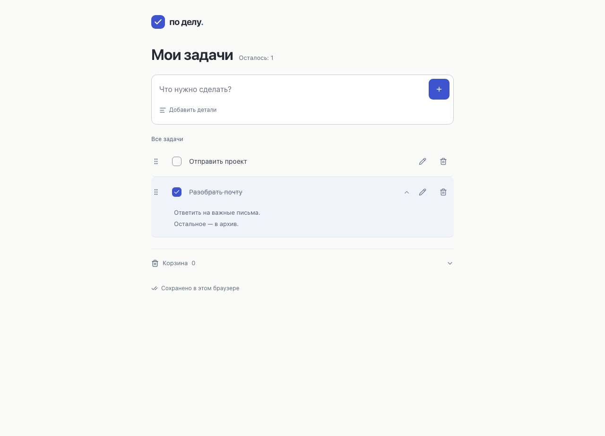

# По делу

Список задач с заголовками и описаниями: добавляйте дела, раскрывайте детали, меняйте порядок и продолжайте после обновления страницы.

[Открыть сайт](https://lordronn.github.io/po-delu/) · [Проверки CI](https://github.com/lordronn/po-delu/actions/workflows/ci.yml)



## Запуск

Node.js **22.21+** и npm. Версия для воспроизводимого окружения указана в `.nvmrc`.

```sh
npm ci
npm run dev
```

```sh
npm run typecheck       # Строгая проверка приложения, конфигурации и тестов
npm run format:check    # Форматирование
npm run test:coverage   # Логика, схема данных, сохранение и контроллер
npm run build          # Production-сборка в dist/
npx playwright install chromium
npm run test:e2e        # Браузерные сценарии на production-сборке
npm run preview        # Локальный просмотр сборки

# Расширенная локальная матрица: Chromium + WebKit, три размера каждого движка
npx playwright install webkit
CROSS_BROWSER=1 npm run test:e2e

# Отдельный необязательный прогон Firefox в окружении, где движок запускается
npx playwright install firefox
FIREFOX=1 npm run test:e2e -- --project=firefox
```

`npm run check` объединяет типы, форматирование, unit-тесты и сборку. E2E запускаются отдельно после сборки.

## Возможности

- Добавление кнопкой или Enter; новые задачи появляются сверху. Пробелы по краям убираются, пустой ввод отклоняется, лимит — 300 UTF-16 единиц, как у HTML `maxlength`. Одинаковые названия допустимы.
- Единая форма: «Добавить детали» раскрывает описание и переводит фокус в него; сворачивание сохраняет черновик, добавление очищает форму. Описание задачи полностью скрыто до раскрытия заголовком или стрелкой.
- Описание по желанию: до 2000 UTF-16 единиц, с сохранением переносов строк. Заголовок и стрелка раскрывают детали только при наличии описания; чекбокс независимо отмечает выполнение.
- Карандаш и корзина доступны прямо в строке одним нажатием. Ручка переноса расположена слева и не заменяет редактирование.
- Изменение заголовка и описания с сохранением статуса и позиции. При внешней правке черновик остаётся в редакторе: можно загрузить актуальную версию или добавить черновик отдельной задачей.
- Drag-and-drop за отдельную ручку: мышь, Pointer Events и клавиатура. Пробел/Enter начинает и завершает перенос, стрелки выбирают позицию, Escape отменяет. Ручка слева доступна сразу, когда в списке больше одной задачи. Отдельного режима сортировки нет. Для касания используется удержание ручки, затем перенос; соседние задачи плавно освобождают место во время переноса, а порядок сохраняется только после отпускания. Escape возвращает исходную раскладку без записи. Кнопок «Выше/Ниже» нет.
- Заголовок в списке занимает одну строку на компьютере и до двух на телефоне; длинный текст сокращается многоточием и остаётся полностью доступен в редакторе.
- Выполненная задача плавно перемещается в конец списка, возвращённая в работу — в начало. Соседние строки освобождают место; системное уменьшение движения отключает анимацию. Новый порядок сохраняется после перезагрузки, ручное перетаскивание остаётся доступно.
- Удаление с отменой **последнего** удаления. Восстановление ориентируется на соседние задачи даже после перестановки. Отмена не исчезает по таймеру; доступна до следующего удаления, внешнего обновления или перезагрузки.
- Корзина сохраняет удалённые задачи после перезагрузки: можно восстановить любую задачу в начало списка с её описанием и статусом или удалить навсегда с подтверждением. Быстрая отмена последнего удаления возвращает прежнюю позицию; после перезагрузки восстановление доступно через корзину.
- Автоматическое сохранение каждого изменения, включая корзину и отмену удаления.
- Обновление списка между вкладками с сохранением незаконченного ввода.
- Адаптивный интерфейс от 320 px, управление с клавиатуры, подписи элементов и восстановление фокуса после удаления и отмены.

## Интерфейс

Компактный список: короткая шапка, поле добавления с кнопкой «+», раскрываемое описание и задачи сразу под формой. В строке нет дополнительных панелей действий: карандаш и корзина остаются в том же ряду даже на 320 px. Заголовок задачи без описания статичен, поэтому стрелка не обещает пустое раскрытие. Слоганы, вложенные карточки и постоянные инструкции убраны; ручка переноса всегда доступна слева при наличии нескольких задач.

## Решения

**React + TypeScript strict + Vite.** React выбран для готовых компонентов shadcn/ui и предсказуемого обновления небольшого интерфейса. TypeScript проверяет границы модулей; входящие данные дополнительно проверяются во время выполнения. Vite собирает статический сайт.

**Tailwind CSS + shadcn/ui + Lucide; dnd-kit для сортировки.** Только бесплатные компоненты и иконки. Исходники UI-компонентов лежат в `src/components/ui`, палитра и оформление настроены под приложение. Нет платных шаблонов, внешних шрифтов или аналитики.

**Небольшие независимые модули:**

```text
src/domain/tasks.ts    Чистые переходы состояния и проверка ввода
src/data/storage.ts    Проверка схемы и адаптер localStorage
src/app/task-store.ts  Действия, сохранение, подписки и внешние обновления
src/components/        Форма добавления, сортируемые строки, редактор и UI-примитивы
src/App.tsx            Композиция интерфейса и управление фокусом
```

Контроллер подключён через `useSyncExternalStore`. Запись выполняется в явных действиях, а не при рендере или в эффекте: StrictMode и внешние обновления не вызывают повторную запись. UI не содержит логики сериализации. Отдельный state manager и сервер для этого объёма не нужны.

**Сохранение с явными отказами.** Схема v3: `{version: 3, tasks: [...], trash: [...]}`; обе коллекции содержат `{id, title, description, done}`. Проверяются типы, длины полей и уникальность непустых ID без пробелов сразу в обеих коллекциях. ID не привязаны к формату UUID; UUID используется только при создании новых задач. Некорректная или неизвестная схема блокирует запись: исходные данные остаются нетронутыми, временные изменения доступны в памяти. Заменить запись текущим списком можно только после подтверждения. При запрете доступа или превышении квоты список продолжает работать в памяти с постоянным предупреждением; сохранение можно повторить.

**Совместимость данных.** Старая v1-схема `{id, text, done}` читается как `title=text, description=''`; порядок, ID и выполнение сохраняются. Миграция происходит в памяти без записи при открытии страницы. Схема v2 с описаниями тоже читается без изменений; у старых записей корзина пуста. Следующее явное действие записывает v3. Ключ `po-delu:tasks:v1` намеренно оставлен прежним, чтобы существующие записи не потерялись: версию определяет поле внутри записи. После чтения/записи новой схемы входящие записи старых вкладок с меньшей версией блокируются отдельным предупреждением, сохраняя текущие задачи и корзину в памяти. Старые вкладки нужно обновить; полная транзакционная совместимость старого и нового приложения не обещается.

**Сортировка и React.** Используется `@dnd-kit/react`. React владеет и предварительным, и сохранённым порядком; плагин с прямой перестановкой DOM отключён. Во время переноса локальная сессия хранит исходный снимок и текущий preview, а `useSortable` анимирует перемещение соседних строк. Collision detection возобновляется после завершения рендера новой раскладки. Каждая сессия имеет отдельный объект, поэтому отложенные callbacks от отменённого переноса не вмешиваются в следующий. Место вставки берётся из показанного preview, поэтому кратковременная потеря collision-target на границе кадра не откатывает отпускание. В хранилище пишется только завершённый перенос; Escape откатывает UI без записи. При внешнем обновлении preview перестаёт отображаться, а проверка актуальности не позволяет сохранить устаревший порядок. Ref ручки остаётся стабильным отдельным DOM-узлом, чтобы библиотека не назначала draggable-роль всей строке с вложенными кнопками. Undo использует якоря соседних задач, затем прежний индекс. Подходы к управлению состоянием описаны в [документации dnd-kit](https://dndkit.com/react/guides/sortable-state-management/).

## Проверки

- **Vitest:** переходы add/toggle/delete/undo, неизменяемость данных, граничные значения, невалидные схемы, ошибки чтения и записи, восстановление и отсутствие записи при внешнем обновлении.
- **Playwright:** 41 общих пользовательских сценариев на размерах 1280×900, 390×844 и 320×740. Проверяются сохранение каждого действия после перезагрузки, клавиатура, Undo, безопасное отображение HTML-подобного текста, повреждённые данные, квота, запрет доступа, несколько вкладок, длинные строки, описание и редактор, реальный перенос мышью/клавиатурой, его отмена, перетаскивание, Undo после сортировки и переход со старого формата.
- **axe:** автоматические проверки WCAG A/AA в пустом и заполненном состояниях, после удаления, в раскрытой корзине, при ошибке ввода, сбое хранилища, конфликте вкладок и редактора, а также в диалоге с длинным описанием. Дополняются ручной визуальной проверкой; это не заявление о полной WCAG-сертификации. Работа со скринридером отдельно не верифицирована.

Дополнительный локальный прогон включает WebKit на тех же трёх размерах. Отдельный сценарий с доверенными touch-событиями браузера через Chromium CDP выполняется на двух мобильных размерах; в desktop и WebKit этот CDP-сценарий неприменим и отмечен skipped. Общие сценарии проверяют мышь и клавиатуру во всех движках. Проверяется также редактор в горизонтальном окне 740×360 и с отключённой анимацией. На macOS сценарий полной клавиатурной навигации WebKit использует Option-Tab, как предусмотрено поведением движка. Координаты drop-цели считываются после установки drag placeholder. Отдельно проверяется смещение соседней строки до отпускания, отсутствие записи во время preview, повторные cancel/drop и внешнее удаление активной задачи.

CI выполняет проверку типов, форматирования, тесты с покрытием, сборку и E2E в Chromium. Публикация разрешена только после успешных проверок. При сбое сохраняются HTML-отчёт, скриншоты и трассировки Playwright.

## Ограничения

Данные привязаны к браузеру и origin сайта: нет аккаунтов, синхронизации устройств и серверного резервирования. Очистка данных браузера удаляет список. `localStorage` синхронный и подходит для небольшого личного списка; это не защищённое хранилище секретов.

Событие `storage` обновляет другие вкладки. Одновременные записи не являются транзакциями: действует **last write wins**. Внешнее изменение сбрасывает Undo. Если локальные правки ещё не удалось сохранить, они остаются в текущей вкладке, а конфликт показывается отдельным предупреждением. Замена сохранённого списка локальным требует подтверждения; обновление страницы открывает сохранённый список и теряет временные правки. ID создаются через `crypto.randomUUID()`; требуется HTTPS или localhost.

Постоянная CI-матрица — Chromium; дополнительная локальная — Chromium и WebKit. Firefox настроен опционально, но в текущем окружении не смог открыть временный профиль ещё до загрузки приложения, поэтому результат в Firefox не заявляется. Мобильные размеры проверяются эмуляцией, а не на физических устройствах; WebKit Playwright не равен проверке на настоящем iPhone с экранной клавиатурой.

## Публикация

GitHub Pages публикует `dist/` через `.github/workflows/ci.yml` после проверок ветки `main`. В настройках Pages выбран источник **GitHub Actions**. Относительный `base` в Vite позволяет открывать сборку по адресу репозитория `/po-delu/`.

[Строгая оценка перед отправкой: вопросы для защиты и ограничения](docs/review.md).

## Использование AI

- **Codex:** реализация приложения, оформление, автоматические тесты, браузерная проверка и публикация.
- **Claude Code:** независимая критика требований и архитектуры, ревью исходников и тестов, повторная проверка исправлений.

Рекомендации AI проверялись и сопоставлялись с требованиями. Разбор и ревью не заменяли запуск тестов и проверку интерфейса.

MIT. Компоненты [shadcn/ui](https://ui.shadcn.com), [Radix UI](https://www.radix-ui.com) и иконки [Lucide](https://lucide.dev) используются согласно их открытым лицензиям.
